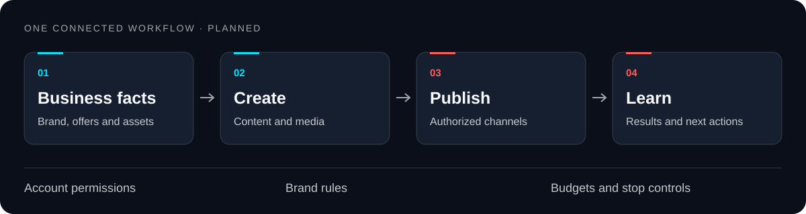

<p align="center">
  
</p>

<h1 align="center">MaexSocial</h1>
<p align="center">AI-powered local visibility, social operations and creative production.</p>
<p align="center">
  <a href="https://github.com/Maeximilion/MaexSocial/actions/workflows/ci.yml"></a>
  <a href="https://github.com/users/Maeximilion/projects/5"></a>
  <a href="docs/01_STATUS.md"></a>
</p>
<p align="center">
  <a href="docs/README.md">Documentation</a> ·
  <a href="docs/07_WORKPACKAGES.md">Roadmap &amp; tasks</a> ·
  <a href="docs/handovers/claude-rea.md">Claude handover</a> ·
  <a href="CONTRIBUTING.md">Contributing</a>
</p>

## One place to grow your presence

MaexSocial is being designed to turn approved business facts and product images into useful content, channel-specific posts and creative campaigns. Its goal is to connect local discovery, account care and media production through AI and supported APIs.

> [!NOTE]
> **Current stage — discovery.** The repository foundation and GitHub automation are operational. Application features are planned. Independent research and an approved product design precede implementation.

| Planned capability | What it should help a business do |
| --- | --- |
| **Local visibility** | Maintain business profiles, offers, products and reputation |
| **Social operations** | Prepare, schedule and publish content through authorized accounts |
| **Creative production** | Turn approved photos and briefs into images and advertising videos |
| **Bounded autonomy** | Operate within account permissions, brand rules and cost limits |

## From business facts to published content



1. **Bring the facts.** Establish brand identity, offers and approved source assets.
2. **Create the content.** Prepare text, images and video for the selected channels.
3. **Publish with authority.** Apply account permissions, approval policy and schedule.
4. **Measure and improve.** Use observed results to plan the next action.

These steps define the product direction. Provider availability, platform restrictions and implementation contracts are research and design decisions.

## Where the project stands

| Gate | Goal | State |
| --- | --- | --- |
| [G0 · Foundation](https://github.com/Maeximilion/MaexSocial/issues/13) | Repository, Project, checks and delivery workflow | Complete |
| [G1 · Discovery](https://github.com/Maeximilion/MaexSocial/issues/14) | Independent research and API feasibility, reconciled with evidence | In progress |
| [G2 · Design](https://github.com/Maeximilion/MaexSocial/issues/15) | Approved scope, architecture and executable task plan | Planned |
| [G3 · First slice](https://github.com/Maeximilion/MaexSocial/issues/16) | One tested end-to-end publishing workflow | Planned |
| [G4 · Creative](https://github.com/Maeximilion/MaexSocial/issues/17) | Verified image-to-video production | Planned |
| [G5 · Autonomy](https://github.com/Maeximilion/MaexSocial/issues/18) | Controlled operation, monitoring and recovery | Planned |

Goals, gate criteria, dependencies and task IDs are defined. Detailed product implementation plans follow the G1 evidence and G2 design decision. Track current work in the [Project](https://github.com/users/Maeximilion/projects/5), [status](docs/01_STATUS.md) and [work packages](docs/07_WORKPACKAGES.md).

## Research with evidence

SocialEdge is the comparison baseline. The [Codex report](docs/research/codex-rea.md) analyzes three public JavaScript bundles and records partial coverage in its [evidence manifest](docs/research/evidence-codex.json). Authenticated workflows and backend behavior remain unverified.

The [Claude assignment](docs/handovers/claude-rea.md) requires independent observations followed by an evidence-by-evidence comparison. Findings may confirm, contradict or extend the baseline, or remain unverifiable. The [synthesis brief](docs/handovers/synthesis.md) brings both reports together before the product design is approved.

## Start here

For repository checks, use Git, Python 3.12 or newer and Node.js 22 or newer. GitHub maintenance also requires an authenticated GitHub CLI.

```sh
git clone https://github.com/Maeximilion/MaexSocial.git
cd MaexSocial
python scripts/check_repo.py
python -m unittest discover -s tests
node --test tests/pr_metadata.test.cjs
```

For an existing clone, check for local changes before fetching and fast-forwarding `main`. Make changes in a separate task worktree. Follow the [agent playbooks](docs/12_CLAUDE_CODE_PLAYBOOKS.md).

| If you are here to… | Start with… |
| --- | --- |
| Understand the product and gates | [Project charter](docs/00_PCF.md) |
| Perform the independent Claude investigation | [Claude REA handover](docs/handovers/claude-rea.md) |
| Compare the research lanes | [Synthesis handover](docs/handovers/synthesis.md) |
| Work on an issue | [Contributing](CONTRIBUTING.md), [AGENTS.md](AGENTS.md) and [CLAUDE.md](CLAUDE.md) |
| Maintain GitHub automation | [Project operations](docs/16_GITHUB_PROJECT.md) |
| Understand access and security requirements | [Registration, customer and admin access](docs/17_ACCESS_SECURITY.md) |
| Use the visual identity | [Brand and asset guide](docs/15_README_STRATEGY.md) |

## Repository map

```text
.github/       Workflows, templates, branch rules and visual assets
.claude/       Shared task, gate and handover commands
.agents/       Codex entry points for the shared commands
docs/          Charter, status, design questions and work packages
  research/    Sanitized findings and evidence manifests
  handovers/   Independent research, synthesis and build briefs
  superpowers/ Design records and implementation plans
scripts/       Repository validation and Project reconciliation
tests/         Regression checks for the repository tooling
```

## Working together

Issues describe a deliverable and its acceptance evidence. Pull requests link their tasks, pass checks and receive review. GitHub Project synchronization maintains delivery status while preserving planning fields. Release gates require the evidence defined in the charter.

Use [task and bug forms](https://github.com/Maeximilion/MaexSocial/issues/new/choose) for scoped work and [SECURITY.md](SECURITY.md) for private vulnerability reporting. The [changelog](CHANGELOG.md) records repository changes.

## License

Copyright 2026 Maeximilion. Publicly readable, proprietary. Original brand assets follow the repository license. See [LICENSE](LICENSE).
