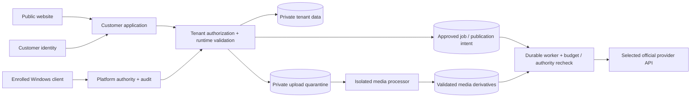

# Application anatomy — G2 proposal

This is a directory and responsibility proposal for [MS-008](https://github.com/Maeximilion/MaexSocial/issues/8), not a scaffold or accepted deployment architecture. [ADR 0001](../decisions/0001-application-language.md) assigns the languages for the local pilot selected on [#8](https://github.com/Maeximilion/MaexSocial/issues/8#issuecomment-6671380463).

## Small first release

Prefer a modular application with one complete customer journey. Keep public pages, customer screens and the separately installed Windows admin client easy to navigate. A different route alone does not establish an authorization boundary. Background publication needs durable state; hostile media processing needs actual runtime isolation, not merely a different folder.

```text
apps/                         Introduce only with accepted implementation tasks
  web/
    src/
      routes/                 Public site and customer entry points
      features/               Access, workspaces, library, content, calendar
      server/                 Authorization, validated APIs and persistence
  admin-windows/              C#/.NET WPF client for the private admin API
  worker/
    src/                      Durable generation/publication jobs and recovery
  media-processor/
    src/                      Restricted decoding/transcoding process
packages/
  contracts/                  Shared validated schemas, only when reused
tests/
  integration/                Tenant, storage, job and provider boundaries
  e2e/                        Customer browser and Windows admin journeys
```

Framework routing conventions may change these names. Extract shared packages only when there are real consumers; do not create empty packages for every domain. Keep deployment files beside the selected deployment setup when it exists. Existing Python/Node repository tooling remains independent.

## Trust boundaries to approve



| Boundary | Required contract |
|---|---|
| Public/customer/admin | Server-side role/action checks, verified identity, separate platform privilege and explicit target tenant |
| Application/data | Tenant scope on reads, writes, exports, assets and jobs; secrets never returned to browser/model |
| Upload/processor | Private quarantine, bounded format decoding, no application/admin/provider credentials, constrained filesystem/network |
| Processing/media | Promote only validated derivatives; authorize every retrieval; explicit retention/revocation |
| Intent/worker | Immutable approved revision, current authority, idempotency/reconciliation, reserved cost and stop behavior |
| Worker/provider | Selected API capability, scoped credentials, authenticated callbacks where supported and validated output retrieval |

Use [access requirements](../17_ACCESS_SECURITY.md), [upload security](../security/uploads.md) and [media lifecycle](../18_MEDIA_LIBRARY.md) as design inputs. The diagram does not prove these controls exist. MS-009 must assign exact files, runtime isolation, data contracts and executable acceptance tests after owner approval.
